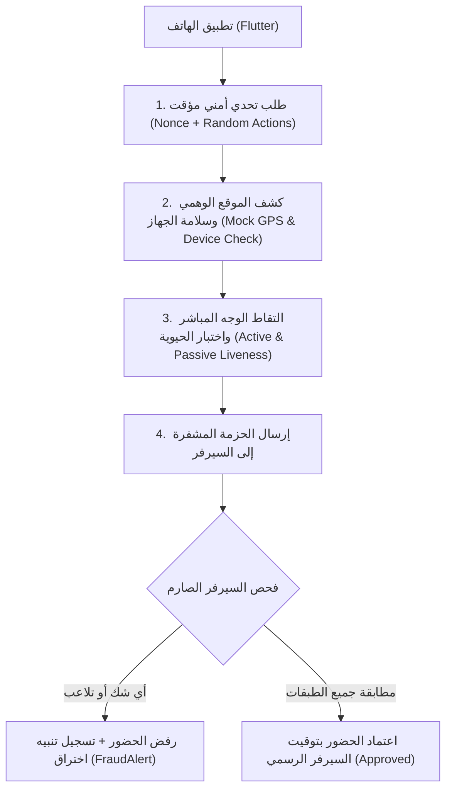

# Anti-Cheat Mobile Attendance System 🛡️
### نظام حضور وانصراف ذكي غير قابل للتخطي ببصمة الوجه والموقع الجغرافي

---

## 1. قاعدة البيانات المناسبة ولماذا تم اختيارها؟

قاعدة البيانات المعتمدة للنظام هي: **PostgreSQL 16+** مع إضافتي:
1. **`pgvector`**: لتخزين متجهات بصمة الوجه عالية الأبعاد (512-dimension Feature Vectors) والبحث الفوري عن التشابه عبر مؤشرات **HNSW** و **Cosine Similarity** (`<=>`).
2. **`PostGIS`**: لحسابات الموقع الجغرافي والنطاقات المكانية (Geofencing) بأعلى دقة رياضية عبر دوال مثل `ST_DWithin`.
3. **`Redis`** (مساعد في الذاكرة): لإدارة رموز التحدي المؤقتة (Challenge Nonce TTL = 40s) ومنع هجمات التكرار (Replay Attacks) ومعدل الطلبات.

### مقارنة مع البدائل:
| المعيار | PostgreSQL (مع pgvector & PostGIS) | MongoDB | MySQL العادية |
| :--- | :--- | :--- | :--- |
| **تخزين ومطابقة بصمات الوجه (Vector Search)** | ⭐️⭐️⭐️⭐️⭐️ عبر `pgvector` و `HNSW` | ⭐️⭐️⭐️ عبر Atlas Search (محدود محلياً) | ❌ غير مدعوم أصلياً |
| **دقة الجيوفينس وحساب المسافات الجغرافية** | ⭐️⭐️⭐️⭐️⭐️ عبر `PostGIS` فائق الدقة | ⭐️⭐️⭐️ تقريبي (2D Spherical) | ⭐️⭐️ أساسي وبطيء في المعالجة |
| **موثوقية سجلات الحضور والرواتب (ACID)** | ⭐️⭐️⭐️⭐️⭐️ دقة مالية وقانونية تامة | ⭐️⭐️⭐️ Document-based | ⭐️⭐️⭐️⭐️ جيدة ولكن تنقصها أدوات الذكاء الاصطناعي |

---

## 2. طبقات الحماية الخمس (منع التخطي بنسبة 99.9%)



1. **كشف المواقع الوهمية (Anti-Mock GPS & Geofencing):**
   * كشف وتجريم تفعيل `isMocked` من أندرويد ورفض التطبيقات الخبيثة مثل Fake GPS.
   * حساب المسافة الدقيقة بين الموظف وإحداثيات المقر عبر معادلة Haversine.
2. **المرساة الفيزيائية (Physical Anchors):**
   * مطابقة عنوان الـ MAC (BSSID) لراوتر الشركة أو إشارة جهاز **BLE Beacon** داخل المكتب لمنع التواجد الوهمي.
3. **حماية بصمة الوجه وكشف الحيوية (Liveness & 1:1 Face Matching):**
   * تحدي حركي عشوائي يتغير كل مرة (رمش، حركة رأس، ابتسامة).
   * فحص الحيوية السلبي لكشف الصور والورق والشاشات (Passive Liveness Score >= 0.70).
   * مطابقة متجهات الوجه (Cosine Similarity >= 0.82) ضد بصمة الموظف المسجلة في السيرفر.
4. **ربط الحساب بجهاز واحد (Hardware Device Binding):**
   * بصمة مشفرة للجهاز (SHA-256 Hardware Fingerprint) محفوظة في Secure Storage / KeyStore.
   * منع أي موظف من تسجيل الحضور نيابة عن زميله من هاتف آخر.
5. **ساعة السيرفر ومنع إعادة الإرسال (Server-side NTP & Replay Protection):**
   * اعتماد توقيت السيرفر فقط وتجاهل ساعة هاتف الموظف تماماً.
   * إبطال رمز الـ Nonce فور استخدامه لمنع إعادة إرسال الطلب (Replay Attack).

---

## 3. هيكل المشروع المُنجز

```text
attendance-system/
├── app/
│   ├── config.py                 # إعدادات النظام وعتبات الأمان
│   ├── database.py               # ربط قاعدة البيانات
│   ├── models.py                 # جداول الـ ORM (Branches, Employees, Devices, Logs, FraudAlerts)
│   ├── schemas.py                # نماذج التحقق Pydantic
│   ├── security/
│   │   ├── geo_verifier.py       # محرك فحص الموقع والمرساة الفيزيائية
│   │   ├── device_verifier.py    # محرك التحقق من ارتباط الجهاز
│   │   └── biometric_verifier.py # محرك مطابقة الوجه واختبار الحيوية
│   ├── routers/
│   │   ├── attendance.py         # واجهات تسجيل الحضور وطلب التحدي
│   │   └── admin.py              # واجهات الإدارة وتسجيل الموظفين والفروع
│   └── main.py                   # نقطة انطلاق تطبيق FastAPI
├── tests/
│   └── test_anti_cheat_pipeline.py # 6 اختبارات أوتوماتيكية تثبت صد جميع محاولات التلاعب
├── mobile_starter/
│   ├── security_checker.dart     # كود فلاتر لفحص الروت والموقع الحقيقي والـ BSSID
│   └── attendance_service.dart   # كود فلاتر للتواصل المشفر مع السيرفر
├── schema.sql                    # كود إنشاء جداول PostgreSQL مع pgvector و PostGIS
├── docker-compose.yml            # بيئة تشغيل سحابية متكاملة بضغطة زر
└── requirements.txt
```

---

## 4. كيفية التشغيل والاختبار

### تشغيل الاختبارات الآلية (Automated Tests):
تم إعداد واختبار 6 سيناريوهات أمنية تثبت منع التخطي:
```powershell
cd C:\Users\Administrator\.gemini\antigravity\scratch\attendance-system
.\venv\Scripts\python -m pytest -v tests
```
**النتيجة**:
* `test_happy_path_punch_in`: نجاح الحضور الشرعي.
* `test_cheat_attempt_mock_gps`: صد وإفشال محاولة Fake GPS بنجاح.
* `test_cheat_attempt_out_of_geofence`: صد الموظف المتواجد خارج نطاق الشركة.
* `test_cheat_attempt_face_spoof_low_liveness`: كشف استخدام صورة أو شاشة بدلاً من الوجه الحي.
* `test_cheat_attempt_device_mismatch`: صد محاولة تسجيل موظف لحساب زميله من هاتف مختلف.
* `test_cheat_attempt_replay_attack`: صد محاولة إعادة إرسال نفس الطلب بعد استهلاكه.

### تشغيل خادم التطبيق (FastAPI):
```powershell
.\venv\Scripts\uvicorn app.main:app --host 0.0.0.0 --port 8000 --reload
```
توثيق الواجهات التفاعلي سيكون متاحاً مباشرة على: `http://localhost:8000/docs`

### التشغيل عبر Docker Compose (الإنتاج):
```bash
docker compose up -d
```

